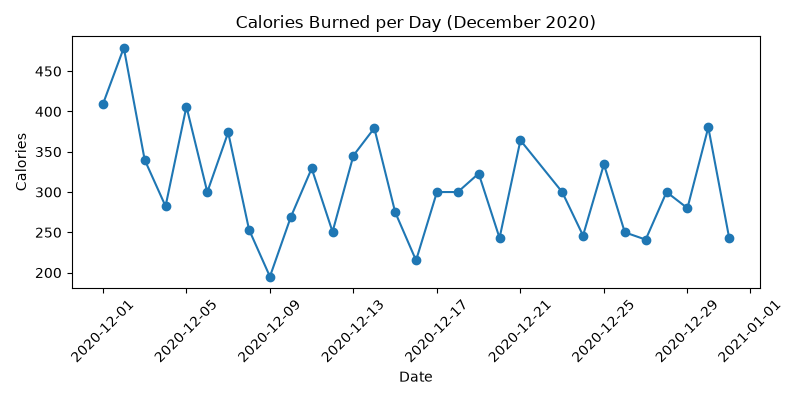
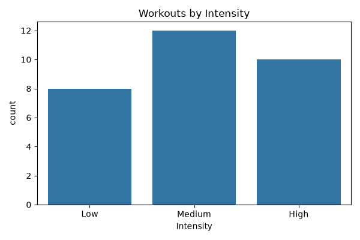

# Python Data Cleaning with Pandas

Cleaning a messy workout dataset with Pandas: handling missing values, fixing wrong values, filtering rows and creating new columns, plus two charts with Matplotlib and Seaborn. This is my Week 3 project for the Data Analyst Course (Python & Data Wrangling).

## Dataset

- File: `data.csv` (raw, messy data)
- 32 rows and 5 columns: Duration (minutes), Date, Pulse, Maxpulse, Calories
- Workout data for December 2020

## Files

- `data_cleaning.ipynb`: the Jupyter notebook with all the code and outputs
- `data.csv`: the original messy dataset
- `cleaned_data.csv`: the cleaned dataset (30 rows, 8 columns)
- `calories_over_time.png`: line chart of calories per day
- `intensity_counts.png`: bar chart of workouts by intensity

## Problems Found and How They Were Fixed

| Problem | Fix |
|---|---|
| 1 duplicate row | Removed with `drop_duplicates()` |
| Dates had extra quote marks | Removed with `str.replace()` |
| 1 date in the wrong format (`20201226`) | Converted all dates with `pd.to_datetime(format="mixed")` |
| 1 row with a missing Date | Removed the row with `dropna()`, because the date can't be known for sure |
| 2 rows with missing Calories | Filled with the median Calories (300.0) |
| 1 Duration of 450 minutes (it burned only 253 calories) | Changed to 45, assuming it was a typo |

After cleaning, the dataset has 30 rows with no missing values.

## New Columns Created

- `Calories_per_min`: Calories divided by Duration
- `Weekday`: day name taken from the Date
- `Intensity`: High (6 or more calories per minute), Medium (5 to 5.99) or Low (below 5)

## Filtering

Workouts with a Duration of 60 minutes or more and Calories of 300 or more: 15 workouts.

## Charts

### Calories Burned per Day

### Workouts by Intensity

## Key Insights

- The average workout lasts 56 minutes and burns about 307 calories, or about 5.5 calories per minute
- The highest calorie burn is 479 calories on 2 December 2020 (60 minutes)
- The lowest is 195 calories on 9 December 2020 (30 minutes)
- 10 workouts are High intensity, 12 are Medium and 8 are Low
- Most workouts (23 of 30) last 60 minutes, and they burn the most calories on average (about 317)

## Tools Used

- Python 3.13
- Pandas, NumPy, Matplotlib and Seaborn
- Jupyter Notebook in VS Code

## How to Run

1. Install the libraries: `python -m pip install pandas matplotlib seaborn ipykernel`
2. Put `data.csv` in the same folder as the notebook
3. Open `data_cleaning.ipynb` and click Run All
